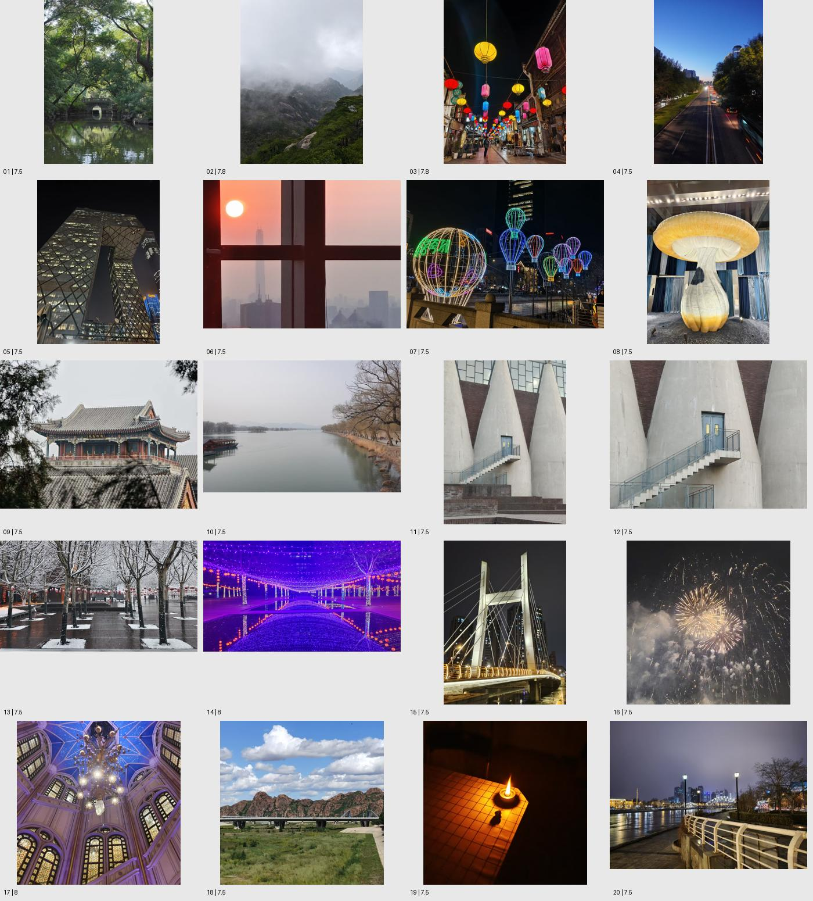
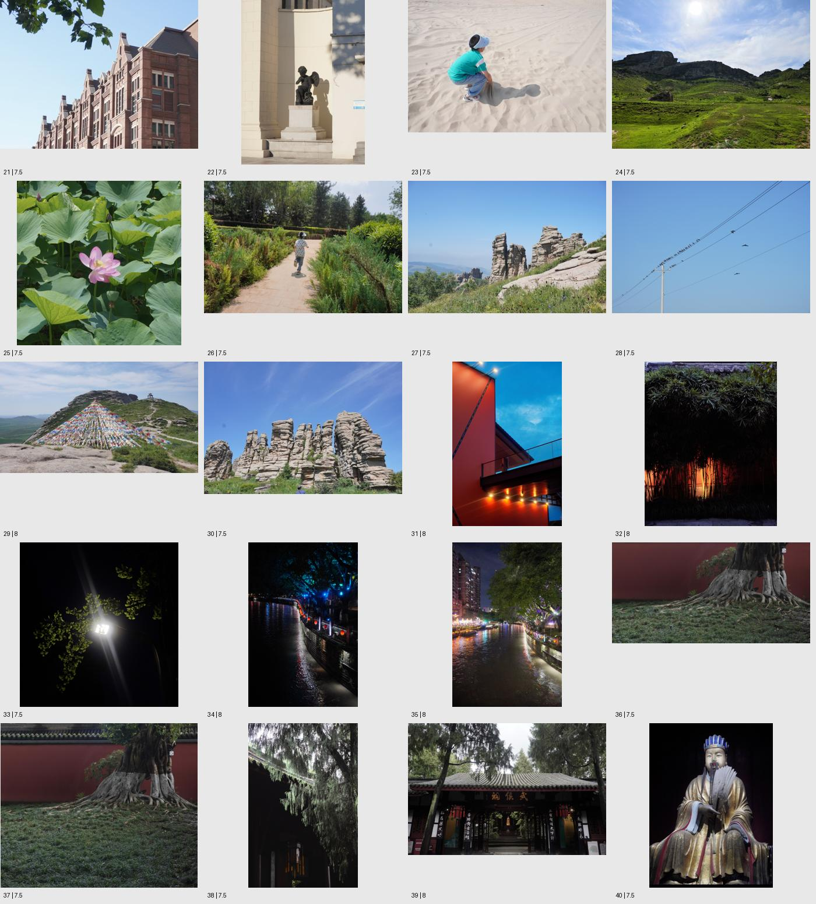
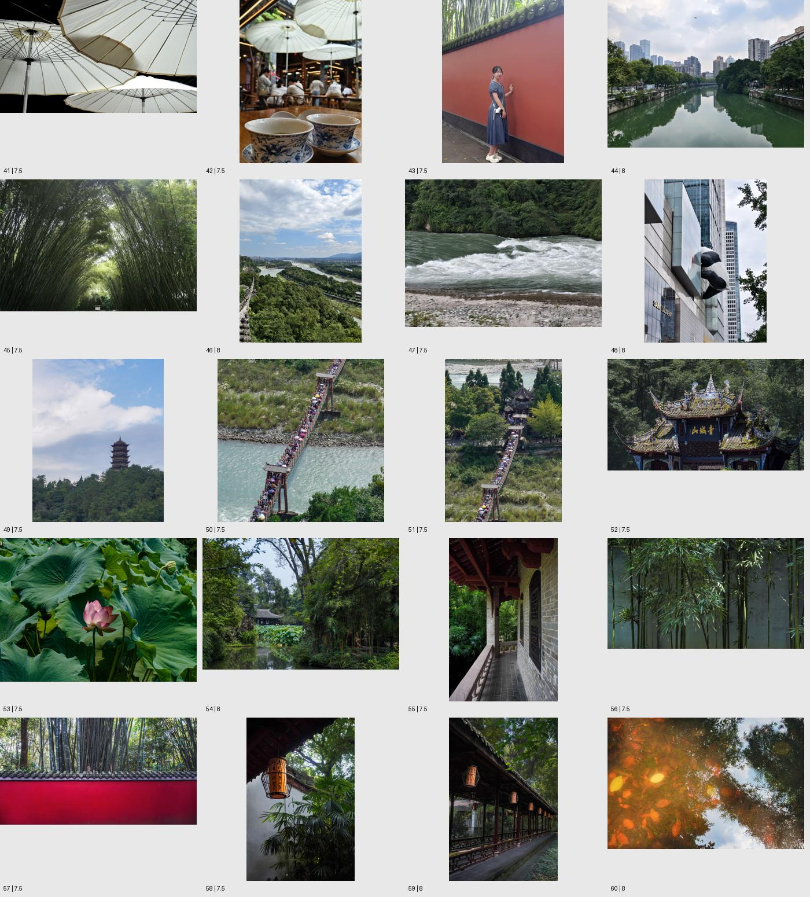
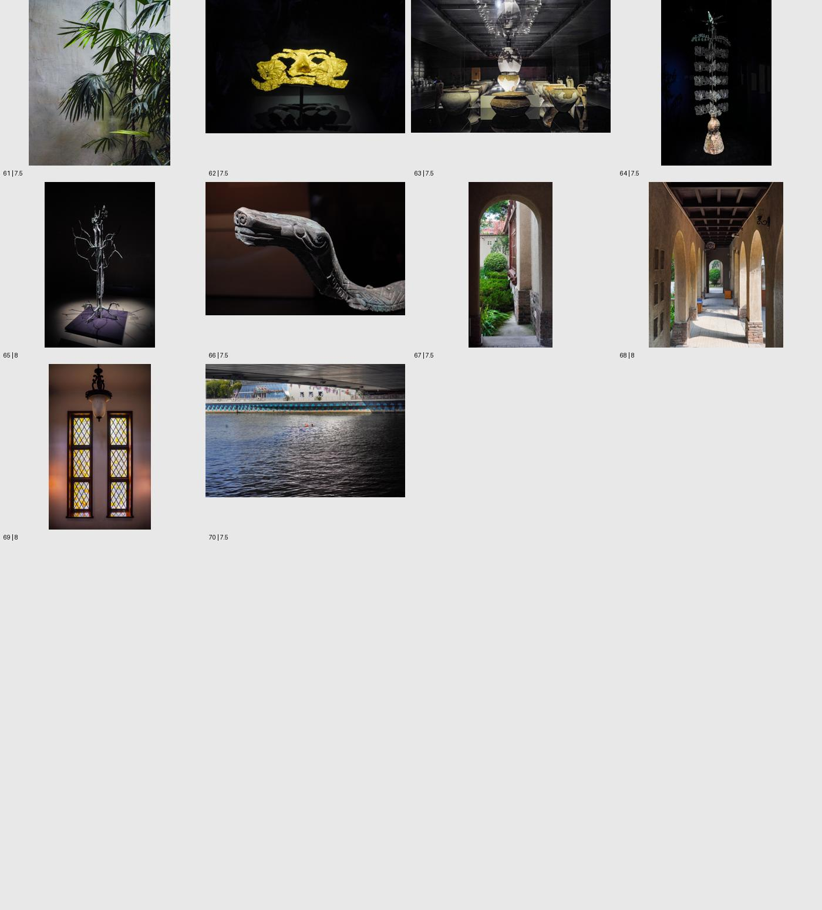

# 把所有高分作品放在一起，会看到什么

## 范围与核验

将高分暂定为既有总体评分7.5及以上。这是分析口径，不是本次重新评级。当前564条归档中，排除49条已确认他人／网络作品，以及10条早期归属未确认条目；其余505条沿用个人作品分析范围（147条早期明确自摄，358条项目后续练习批次），筛出70条。

70条全部有原图和独立点评，原图SHA-256互不重复，但含同场景及近似取景，不视为70个独立创作命题。全部制作方向校正缩览并查看；读取全部70份独立总评，核对350个维度分值与看板一致（其中一份以“故事”命名叙事）。未逐张重新检查像素级清晰度或执行完整重评，不修改原评分。

按分数挑选的结果，会受历史评分口径、选片与题材数量影响；下述数字只能描述这个已筛选集合。它不证明某类题材的成功率，也不能推断比赛水平、获奖概率或近期进步。档案日期不等于拍摄日期。

## 结论

**高分集合显示了一个更明确的优势：能把多种元素组织成连贯的观看经验，尤其在空间引导、光色分区和实体／影像关系上反复取得成功。**它让“尚在摸索的个人兴趣”变成了若干已经有作品证据的方法，同时也暴露了高分作品之间的冗余，以及场景自带美感与摄影者贡献之间的区别。

相比全档案，问题重心从“怎样减少基础失败”，转向“哪些成功最值得继续，哪些高分作品彼此可以替代”。这两种阅读互补，高分集不能替代对稳定性的观察。

## 分数概况

- 7.5分：51条；7.8分：2条；8分：17条。
- 四个维度均值：技术6.97、构图7.69、光线7.17、叙事7.30。
- 达到7.5的维度数量：技术7/70、构图64/70、光线27/70、叙事30/70。

构图在现有评分体系中最突出。这与图像中反复出现的路径、重复、框景、色面及尺度组织相符，但不把分数相关性当成成功的因果证明，也不把这些维度当作严格等距测量。没有按均分重新计算总体。

## 一、最稳的成功方式：把观众带进一个空间

水道、楼梯、桥、河岸、柱廊、树阵和山脊，在不同题材中都能成为有方向的空间组织。锥形立柱与蓝门、水道与亭屋、吊桥与古亭、河道与城市、光影走廊，题材不同，均存在多个元素围绕同一空间关系工作。

这里的构图强项超过“能找一条斜线”：它涉及入口、大小递减、前后层次、视线停留处，以及空间重量的分配。不是每张都需要唯一局部落点，平面形式另有完整性标准。

代表：水道深处的荷塘与亭屋、古树框景中的武侯祠入口、河道／楼群与飞鸟、山顶经幡／山脊与凉亭、光影走廊。

## 二、高分集修正了过窄的“安静低饱和”印象

紫色灯廊、蓝时橙墙、夜市灯笼、蓝色星穹、红灯河湾、琥珀双窗都很鲜明，部分甚至具有舞台感和视觉冲击。这些照片说明，浓色与较强明暗也在有效表达范围内。

较稳定的共同点是光色有明确分工：暗处包围或分隔，亮处定位或连接，颜色承担方向、重复和空间区分。烛火照片与双窗、暗竹暖光、枝状器物聚光，可在这个层面联系起来。

因此，不能将个人风格限定成灰绿、柔和、低饱和。更适合的概括是：**擅长在受控的关系里使用较强的光色反差。**这仍是作品阅读，不推断现场灯光由作者布置。

## 三、值得重点发展的支线：让一个对象产生第二层图像

天使雕塑与翼形投影、金色面具与影子、修复陶器与镜像、枝状金属器与投影、落叶与天空倒影，共同显示一种值得继续的观察：实体之外还存在一个由光、反射或视角形成的形态。

它们的意义不同于单纯重复排列：影子改变尺度，镜像延长结构，水面把上下空间叠合。这个方向可以跨越博物馆、街头与自然，值得作为长期创作线索。

候选优先级不等于分数名次。《天使雕塑与翼形投影》与《落叶与天空倒影》在这条线上能够对话；两张8分但表达方式无关的图，未必适合相邻。展陈光线和雕塑设计的贡献也必须承认，不把所有效果归为作者原创。

## 四、动态与人物不是空白，但最有效时仍与环境结构合作

跑向绿意深处、玩沙孩子与影子、离队飞鸟、吊桥人流、红墙人物、茶院和桥下泳者都进入高分集。

这些例子支持环境中的动作、尺度与位置已经出现成功样本。现有高分证据更集中于“人或动物怎样改变空间关系”，不足以据此宣称近距离人物纪实、复杂互动或快速事件捕捉已稳定。人物数量少也可能受归档题材构成影响，不能直接推算能力差距。

值得延续的是在已组织好的结构里观察变化，同时允许变化反过来改变原有构图，而非永远只让人充当一个色点。

## 五、高分集也揭示了必须区分的两种价值

### 单张完成度

对象清楚，结构、光色与观看关系足够完整。这是既有评分主要衡量的内容。漂亮的建筑、灯光装置、雕塑和景观完全可以有高完成度。

### 作者代表性

这张是否体现一种反复关心的问题？是否提供了具体视角？换成另一张同类图会损失什么？它和其他作品放在一起是否产生新的含义？

蘑菇装置、灯光装置、公共艺术和建筑内景拥有很强的现场设计贡献。摄影有取舍和视角贡献，但高分不自动等于最独特的个人作品。倒影、影子、普通墙边形态等观察，有时更值得优先发展作者性。

没有进行新的排序，也不抹去高分作品既有成绩。只是把“拍得成立”和“最能代表作者”分开使用。

## 六、70条高分材料仍不是一套现成作品集

两张巨柱楼梯、两张红墙树根、两张吊桥人流，以及若干灯廊／暖灯，具有明显的同场景或同语法联系。它们适合学习比较，正式系列中可能只需要其中一张。相似取景不自动构成时间序列，也不能因为分数都高就全部保留。

以下三层用途可帮助二次筛选：

1. 能力样本：证明一种拍法已成功，可以作为学习参照。
2. 作品候选：单张完整，而且有足够具体的观看经验。
3. 系列核心：不仅自身成立，还能与别的照片共同回答某个问题。

同一张照片可以兼任；三层不是新分数。暂时落在第一层，也不等于作品没有价值。

## 下一步：按不同问题选片，而不继续叠加高分

若从这70条开始做作品编辑，我会先建立三个候选组：

- **被引导的空间**：水道、廊道、桥、门与城市河流。每张增加一种不同的进入／抵达体验。
- **光形成的空间**：烛火、暗竹暖光、蓝时橙墙、琥珀双窗与聚光器物。检验光怎样分隔、包围和突出。
- **实体与另一重形态**：倒影、翼形投影、面具影子、陶器镜像与枝状器物投影。检验真实物体与影像如何相互解释。

每组先选6—8张，宁缺毋滥，不为了满额保留同义作品；也不要机械把全部17张8分混为一组。先做候选编辑，最终系列是否成立仍需逐张大图和顺序检查。本次未删除、重排或发布原档案。

## 最终判断

**全部档案显示了兴趣与执行之间的落差；高分集合更明确地显示，你已反复实现的优势是空间组织、光色分工，以及物体之间的映照和尺度关系。**接下来更有价值的突破，是减少成功方式的重复，让这些能力服务一个更具体、连续的问题。

高分集说明已有可供编辑的作品材料，不能单独说明稳定成功率或成熟作者身份。当前分析没有调整任何单张评分，也没有推进正式阶段基线。

## 全部70条高分清单

以下保持存档时间顺序，不作新的名次排序。相邻日期不代表拍摄先后。

| 编号 | 作品 | 技术 | 构图 | 光线 | 叙事 | 总体 |
|---|---|---:|---:|---:|---:|---:|
| 01 | [园林小桥与树冠倒影](../../data/archive/20260604-ceb0eee8/critique.md) | 7.2 | 7.7 | 7.2 | 7.4 | 7.5 |
| 02 | [云雾山谷](../../data/archive/20260604-132642-87888d3c/critique.md) | 7.4 | 7.8 | 7.5 | 7.7 | 7.8 |
| 03 | [夜市灯笼街景](../../data/archive/20260604-135047-7cd48bcf/critique.md) | 7.4 | 7.8 | 8 | 7.6 | 7.8 |
| 04 | [蓝调道路夜景](../../data/archive/20260608-165934-515c3c47/critique.md) | 6.7 | 7.5 | 7.4 | 7.2 | 7.5 |
| 05 | [低机位城市建筑夜景](../../data/archive/20260609-104132-22fd8070/critique.md) | 7.2 | 7.5 | 7.4 | 7.2 | 7.5 |
| 06 | [窗框中的夕阳城市剪影](../../data/archive/20260609-104329-5d59f884/critique.md) | 6.8 | 7.4 | 7.8 | 7.2 | 7.5 |
| 07 | [城市夜晚热气球灯光装置](../../data/archive/20260609-105129-e24140ae/critique.md) | 7.2 | 7.2 | 7.8 | 6.8 | 7.5 |
| 08 | [室内蘑菇装置](../../data/archive/20260609-105550-097f0d95/critique.md) | 7 | 7.5 | 7 | 6.6 | 7.5 |
| 09 | [树影框景中的古建屋檐](../../data/archive/20260609-111632-a8335603/critique.md) | 7 | 7.5 | 6.5 | 6.8 | 7.5 |
| 10 | [雾天湖岸与画舫](../../data/archive/20260609-123238-34f09638/critique.md) | 7 | 7.5 | 7.2 | 7.2 | 7.5 |
| 11 | [锥形立柱间的楼梯与门](../../data/archive/20260711-143415-concrete-cones-staircase/critique.md) | 7 | 7.8 | 6 | 7 | 7.5 |
| 12 | [巨柱之间的蓝门](../../data/archive/20260711-143615-39ae4c58/critique.md) | 7 | 7.5 | 6.5 | 7 | 7.5 |
| 13 | [雪树间的红灯笼街景](../../data/archive/20260711-162436-snow-trees-red-lanterns/critique.md) | 7.2 | 7.6 | 6.8 | 7.5 | 7.5 |
| 14 | [紫色灯廊与水面倒影](../../data/archive/20260711-182413-purple-light-corridor-reflection/critique.md) | 7 | 8.4 | 8 | 7.8 | 8 |
| 15 | [斜拉桥双塔夜景](../../data/archive/20260711-184833-cable-bridge-night/critique.md) | 6.7 | 7.8 | 7.2 | 6.7 | 7.5 |
| 16 | [金色烟花夜空](../../data/archive/20260711-185041-golden-fireworks-night/critique.md) | 6.5 | 7.5 | 7.2 | 7 | 7.5 |
| 17 | [蓝色星穹下的吊灯](../../data/archive/20260711-185206-178571dd/critique.md) | 6.5 | 8 | 7.5 | 7.5 | 8 |
| 18 | [积云、赤岩与横桥](../../data/archive/20260711-185432-baa06238/critique.md) | 7 | 7.5 | 7 | 6.5 | 7.5 |
| 19 | [黑暗桌角的一盏烛火](../../data/archive/20260711-185503-candle-dark-table/critique.md) | 6.5 | 7.6 | 7.8 | 7.2 | 7.5 |
| 20 | [滨河步道、桥梁与城市夜景](../../data/archive/20260711-190135-riverfront-bridge-skyline-night/critique.md) | 7.1 | 7.7 | 7.4 | 6.8 | 7.5 |
| 21 | [蓝天下的红砖山墙](../../data/archive/20260721-225306-red-brick-gables/critique.md) | 7.3 | 7.8 | 7.2 | 6.7 | 7.5 |
| 22 | [天使雕塑与翼形投影](../../data/archive/20260721-230447-b6b82fe2/critique.md) | 6 | 7 | 7.5 | 7.5 | 7.5 |
| 23 | [沙地上玩耍的孩子与影子](../../data/archive/20260729-122516-child-sand-play-shadow/critique.md) | 6.7 | 7.6 | 6.8 | 7.7 | 7.5 |
| 24 | [逆光山谷](../../data/archive/20260729-124311-93eb1bf2b2ca/critique.md) | 6.6 | 7.5 | 7.1 | 7 | 7.5 |
| 25 | [荷花、花苞与莲蓬](../../data/archive/20260729-153826-centered-lotus-bud-seedpod/critique.md) | 7.5 | 7 | 6 | 6.5 | 7.5 |
| 26 | [跑向绿意深处](../../data/archive/20260729-172017-child-running-green-corridor/critique.md) | 6.8 | 7.4 | 6.1 | 7.6 | 7.5 |
| 27 | [蓝天下的岩柱与高山花坡](../../data/archive/20260729-193040-mountain-rock-pillars-wildflower-meadow/critique.md) | 6.8 | 7.6 | 6.3 | 7.2 | 7.5 |
| 28 | [电线上的鸟群与离队飞鸟](../../data/archive/20260729-193600-birds-on-diagonal-power-lines-blue-sky/critique.md) | 6.5 | 7.8 | 5.8 | 7.7 | 7.5 |
| 29 | [山顶经幡、山脊与凉亭](../../data/archive/20260729-193912-prayer-flags-mountain-pavilion/critique.md) | 7.4 | 8.2 | 6.6 | 8 | 8 |
| 30 | [蓝天下的岩柱群](../../data/archive/20260729-200521-rock-pillars-blue-sky/critique.md) | 7 | 7.6 | 6.3 | 7.1 | 7.5 |
| 31 | [蓝时橙墙](../../data/archive/20260805-094249-blue-hour-orange-architecture/critique.md) | 7.2 | 8.1 | 8.2 | 7.8 | 8 |
| 32 | [暗竹后的暖光](../../data/archive/20260805-101523-warm-lit-bamboo-dark-courtyard/critique.md) | 6.8 | 7.9 | 8.3 | 8 | 8 |
| 33 | [穿过银杏叶的夜灯](../../data/archive/20260805-102428-night-lamp-ginkgo-light-rays/critique.md) | 6.6 | 7.5 | 8.1 | 7.2 | 7.5 |
| 34 | [蓝树下的红灯河湾](../../data/archive/20260805-103645-curving-lantern-canal-blue-trees/critique.md) | 7.1 | 8.3 | 8.1 | 7.8 | 8 |
| 35 | [两岸灯火汇入夜河](../../data/archive/20260805-104705-two-bank-night-canal-color-reflections/critique.md) | 7 | 8.2 | 7.7 | 7.8 | 8 |
| 36 | [红墙前的巨树根系](../../data/archive/20260809-124331-giant-roots-red-wall-negative-space/critique.md) | 7.2 | 7.7 | 6.6 | 7.4 | 7.5 |
| 37 | [红墙前铺展的古树根系](../../data/archive/20260809-125329-banyan-roots-red-wall/critique.md) | 7.2 | 7.5 | 6.4 | 7.4 | 7.5 |
| 38 | [垂枝掩映的古寺檐下](../../data/archive/20260809-125341-hanging-foliage-temple-eave-shadow/critique.md) | 6.6 | 7.5 | 6.8 | 7.2 | 7.5 |
| 39 | [古树框景中的武侯祠入口](../../data/archive/20260809-125630-tree-framed-wuhou-shrine-entrance/critique.md) | 7.2 | 8.2 | 7.3 | 7.9 | 8 |
| 40 | [黑背景中的持羽扇金身塑像](../../data/archive/20260809-130902-feather-fan-gilded-statue-portrait/critique.md) | 7.4 | 7.6 | 7.4 | 7 | 7.5 |
| 41 | [交叠白伞的放射结构](../../data/archive/20260810-223125-overlapping-white-parasols-radial-pattern/critique.md) | 7.2 | 7.8 | 7.1 | 7 | 7.5 |
| 42 | [青花杯前的热闹茶院](../../data/archive/20260810-223546-blue-white-teacups-busy-courtyard-parasols/critique.md) | 7.3 | 7.7 | 6.8 | 7.2 | 7.5 |
| 43 | [红墙竹影中的持相机少女](../../data/archive/20260811-133714-red-wall-bamboo-environmental-portrait/critique.md) | 6.8 | 7.7 | 6.7 | 7 | 7.5 |
| 44 | [河道、楼群与飞鸟](../../data/archive/20260811-134455-river-city-skyline-reflection-bird/critique.md) | 7.8 | 8.2 | 7.2 | 7.3 | 8 |
| 45 | [竹林拱廊](../../data/archive/20260811-134549-bamboo-archway-tunnel/critique.md) | 6.5 | 8 | 7 | 6.5 | 7.5 |
| 46 | [云天下的河谷与城市](../../data/archive/20260811-135000-river-valley-city-cloudscape-overlook/critique.md) | 7.5 | 8 | 7.2 | 7.7 | 8 |
| 47 | [森林边的急流](../../data/archive/20260811-135632-forest-river-rapids-pebble-bank/critique.md) | 7.6 | 7.5 | 6.4 | 6.9 | 7.5 |
| 48 | [爬上城市立面的巨型熊猫](../../data/archive/20260811-140917-giant-panda-climbing-city-facade/critique.md) | 7 | 7.5 | 6.5 | 8 | 8 |
| 49 | [云下山巅塔楼](../../data/archive/20260812-204856-hilltop-pagoda-cloudscape/critique.md) | 6.8 | 7.8 | 6.7 | 7.5 | 7.5 |
| 50 | [急流上拥挤的吊桥](../../data/archive/20260812-205744-crowded-suspension-bridge-over-river/critique.md) | 7 | 8 | 6.4 | 7.8 | 7.5 |
| 51 | [人流穿过吊桥通向古亭](../../data/archive/20260812-205918-crowded-suspension-bridge-garden-pavilion/critique.md) | 6.8 | 8 | 6.2 | 8.1 | 7.5 |
| 52 | [阳光下的苔瓦门楼](../../data/archive/20260812-210827-sunlit-mossy-temple-facade/critique.md) | 7.2 | 7.6 | 7.3 | 7.2 | 7.5 |
| 53 | [层叠荷叶中的粉荷](../../data/archive/20260824-161658-pink-lotus-green-leaves/critique.md) | 7.4 | 7.6 | 7.5 | 6.5 | 7.5 |
| 54 | [水道深处的荷塘与亭屋](../../data/archive/20260824-162923-hidden-pavilion-lotus-waterway/critique.md) | 7.8 | 8.2 | 7.4 | 7.8 | 8 |
| 55 | [竹林边的深长廊道](../../data/archive/20260824-163608-covered-corridor-bamboo-perspective/critique.md) | 7.7 | 7.8 | 7.1 | 7.5 | 7.5 |
| 56 | [竹影节奏](../../data/archive/20260824-164909-bamboo-rhythm/critique.md) | 6.8 | 7.5 | 7.5 | 7 | 7.5 |
| 57 | [红墙与竹林](../../data/archive/20260824-193047-red-wall-bamboo-contrast/critique.md) | 7 | 7.5 | 6.5 | 7.5 | 7.5 |
| 58 | [檐下暖灯与深绿庭院](../../data/archive/20260824-193206-lantern-eave-garden/critique.md) | 6.5 | 7.5 | 7.5 | 7 | 7.5 |
| 59 | [灯笼长廊的纵深节奏](../../data/archive/20260824-193520-lantern-corridor-perspective/critique.md) | 6.5 | 8 | 7.5 | 7.5 | 8 |
| 60 | [落叶与天空倒影](../../data/archive/20260824-193626-autumn-leaves-sky-reflection/critique.md) | 7.5 | 8 | 7.5 | 8 | 8 |
| 61 | [墙前棕榈叶](../../data/archive/20260824-194218-palm-leaves-wall-negative-space/critique.md) | 6.5 | 7.5 | 7.5 | 7 | 7.5 |
| 62 | [金色面具与影子](../../data/archive/20260825-142620-gold-mask-shadow/critique.md) | 7 | 7.5 | 8 | 7.5 | 7.5 |
| 63 | [展柜中的修复陶器与镜像](../../data/archive/20260825-144634-museum-ceramics-glass-reflection/critique.md) | 5.5 | 7.5 | 6.5 | 7.5 | 7.5 |
| 64 | [黑暗展柜中的仪式树形器](../../data/archive/20260825-205320-museum-ritual-tree-low-key/critique.md) | 6.5 | 7.5 | 7.5 | 7 | 7.5 |
| 65 | [聚光下的枝状金属器与投影](../../data/archive/20260825-205917-spotlit-branching-bronze-shadows/critique.md) | 6.5 | 7.5 | 8 | 7.5 | 8 |
| 66 | [暖黑背景中的青铜兽首](../../data/archive/20260825-211747-bronze-creature-head-warm-black/critique.md) | 7 | 7.5 | 7.5 | 7.5 | 7.5 |
| 67 | [拱门里的窄庭院](../../data/archive/20261008-arched-garden-0f22d086/critique.md) | 7 | 7.5 | 7.5 | 7 | 7.5 |
| 68 | [光影走廊](../../data/archive/20261008-sunlit-arcade-e48e1522/critique.md) | 7 | 8 | 8 | 7 | 8 |
| 69 | [双窗、吊灯与琥珀色的光](../../data/archive/20261008-amber-windows-88dabfa8/critique.md) | 7 | 8 | 8 | 7 | 8 |
| 70 | [桥影中的游泳者](../../data/archive/20261008-swimmer-under-bridge-813b4e30/critique.md) | 7 | 7 | 7.5 | 7.5 | 7.5 |

## 图像总览

图内编号对应上表。用于看整体关系，不替代原尺寸技术检查。

